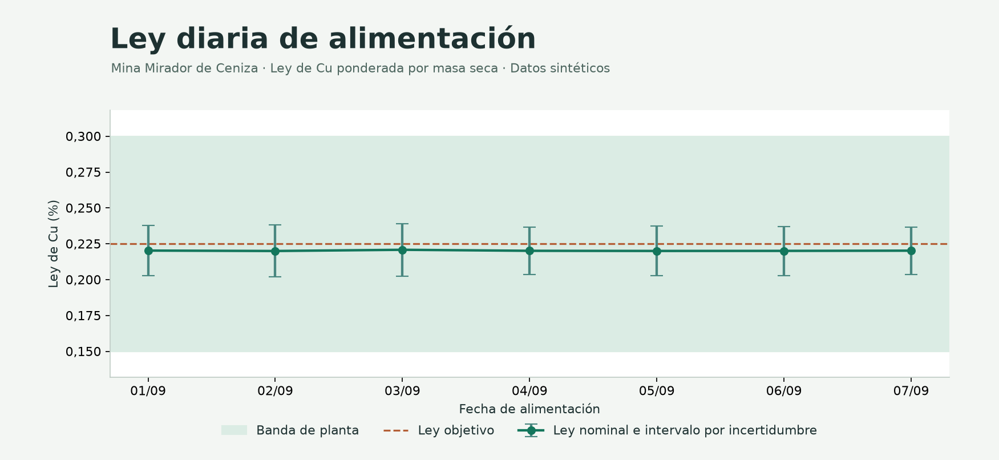

# Blending de cobre · Mina Mirador de Ceniza

Planificador diario para una operación ficticia a tajo abierto. Recibe inventario y leyes por ruma, tonelaje a chancado y capacidad de acarreo. Devuelve cuántos viajes completos retirar de cada ruma por día para que la mezcla cumpla la banda de ley de planta.

## Empieza con tus propias rumas

1. Abre la [guía para geólogos](docs/guia_geologos.md) e instala las dependencias.
2. Ejecuta la [plantilla de dos rumas](datos/plantilla_geologo.json). El ejemplo entrega **24.000 TMH en 100 viajes**, con una mezcla de **0,223265 % Cu**.
3. Copia la plantilla, ingresa tus leyes, humedad, stock, metas de planta y disponibilidad de flota. La guía explica las unidades de cada campo, cómo ejecutar la corrida y cómo leer los resultados.

Si ya instalaste las dependencias en el Python activo, puedes ejecutar la plantilla desde la raíz del proyecto.

```bash
python src/planificar.py --escenario datos/plantilla_geologo.json --salida resultados/tutorial
```

## Caso simulado

| Parámetro | Valor |
| --- | ---: |
| Horizonte | 7 días |
| Rumas / inventario inicial | 6 / 508.800 TMH |
| Ley nominal de las rumas | 0,105–0,472 % Cu |
| Alimentación nominal | 60.000 TMH/día |
| Metas diarias del ejemplo | 57.600–62.400 TMH |
| Banda exigida a la mezcla | 0,150–0,300 % Cu |
| Meta preferida | 0,225 % Cu, con corredor de 0,220–0,230 % Cu |
| Carga efectiva de cada viaje | 240 TMH |
| Flota asignada de cancha a chancado | 8–9 camiones, 17 h efectivas por camión y día |
| Ciclo por ruma | 28–40 min por viaje |

Las leyes y las capacidades son supuestos del caso. La banda de planta es un límite operativo para la mezcla de cada día. La ley de corte económica para decidir qué material extraer o enviar a cancha queda fuera del modelo. Los camiones representan el acarreo desde las rumas hasta chancado. El dimensionamiento de la flota del tajo y el movimiento de desmonte quedan fuera de ese tramo.

## Resultados

El plan entregó **420.000 TMH en 1.750 viajes**, con **0,2202 % Cu de campaña** y **88.800 TMH** de inventario remanente. Cumplió el tonelaje exacto y la banda de planta los siete días, incluso al aplicar las incertidumbres de ley ingresadas. La ley nominal diaria quedó entre **0,21998 % y 0,22083 % Cu**. Seis días quedaron dentro del corredor preferido y un día quedó aproximadamente **0,000015 puntos porcentuales** por debajo. La capacidad efectiva más exigida fue la del **3 de septiembre**, con **8.158 de 8.160 minutos de flota**. Ese día hay poco margen frente a demoras adicionales.



- [Retiro diario por ruma y uso de flota](resultados/02_retiro_y_flota.png).
- [Inventario retirado y saldo por ruma](resultados/03_inventario.png).
- [Plan diario](resultados/plan_diario.csv) con toneladas húmedas y secas, ley, cobre contenido, viajes y carga de flota.
- [Detalle por ruma y día](resultados/retiro_por_ruma.csv) con viajes, retiros y saldos para el despacho.
- [Resumen de campaña](resultados/resumen.json) con indicadores y estado del optimizador.

## Cálculo y restricciones

1. Se elige un número entero de viajes por ruma y día. La masa húmeda retirada es viajes × payload. La masa seca es masa húmeda × (1 − humedad/100).
2. Se obtiene el cobre contenido como masa seca × ley de la ruma/100. La ley diaria es **100 × cobre contenido total / masa seca total**. La ley de campaña se calcula con los totales secos del horizonte.
3. Se verifican el tonelaje diario, la capacidad máxima de retiro, el stock inicial disponible y la flota. Para esta última, la suma de viajes × ciclo de la ruma debe caber en los minutos efectivos de todos los camiones asignados ese día.
4. Los extremos de ley se calculan al desplazar todas las rumas usadas hacia sus valores bajos o altos. Ambos extremos deben respetar la banda de planta. Este intervalo representa los supuestos ingresados y carece de una interpretación probabilística.
5. Dentro de esas restricciones, se minimiza la suma de minutos de acarreo, una penalización por tonelada de Cu equivalente fuera del corredor preferido y 1.000 minutos equivalentes por carga de desviación respecto al tonelaje nominal. El plan se resuelve en conjunto para todo el horizonte. La meta preferida admite desvíos cuando la función objetivo o la factibilidad del plan lo favorecen.

Se usa programación lineal entera mixta con SciPy/HiGHS y una tolerancia relativa de optimalidad de 0,1 %. El programa comprueba los viajes enteros y los balances antes de exportar. Si el escenario es inviable, devuelve un error y no genera un plan nuevo. [Documentación de SciPy sobre MILP](https://docs.scipy.org/doc/scipy/reference/generated/scipy.optimize.milp.html).

El caso supone rumas homogéneas, sin reposición, y ciclos medios constantes. La capacidad de flota se comprueba en minutos agregados. Para llevarlo a operación, valida los datos de ley, humedad y tiempos, y contrasta el plan con la secuencia de acceso a las rumas, las colas en chancado y las restricciones por turno. El cobre calculado es metal contenido en la alimentación. La recuperación metalúrgica, los costos y la rentabilidad requieren sus propios modelos.

